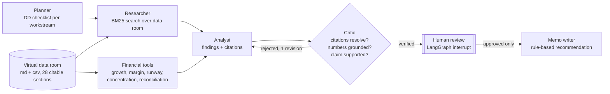

# AI Due-Diligence Analyst

[](https://github.com/Tanzil-Ali-Rizvi/ai-due-diligence-analyst/actions/workflows/ci.yml)


**A multi-agent system that does a first-pass investment due diligence on a startup's data room and writes an investment-committee memo. Every number is computed by code, every claim cites its source, a critic agent rejects anything it can't verify, and a human approves the findings before the memo is written.**

> Analysts spend days reading data rooms to find the handful of issues that change a deal. This system finds them in seconds and shows its evidence, while keeping a person in charge of the final call.

---

## What it found

The bundled data room belongs to **Kirana Ledger Technologies**, a fictional Indian B2B SaaS startup raising a ₹120 crore Series B. Seven red flags are deliberately hidden across 10 documents, alongside two decoys (closed legal matters that a careless analyst would wrongly flag).

| Planted issue | Where it hides | Found |
|---|---|---|
| Claimed revenue ₹48.0 cr vs ₹41.2 cr in the P&L (16.5% overstatement) | management summary vs P&L CSV | ✅ critical |
| Only 8.1 months of cash runway | monthly cash & burn CSV | ✅ high |
| Largest customer is 45% of revenue | revenue-by-customer CSV | ✅ high |
| That customer can terminate on a change of control | clause 14.3 of the MSA | ✅ high |
| ₹6.5 cr patent lawsuit pending, no provision | litigation register | ✅ high |
| KYC data exposure never reported to regulators | data-protection note | ✅ high |
| Co-founder CTO resigned, no successor | key-people doc | ✅ medium |
| *Decoys: settled wage claim, dropped GST notice* | litigation register | ✅ correctly ignored |

**Verdict:** *DO NOT PROCEED until critical issues are resolved* · [sample memo](evals/results/sample_memo.md)

## How it works



**Design choices that matter**

- **LLMs don't do arithmetic.** Revenue growth, margins, runway and concentration come from deterministic Python tools over the CSVs. The LLM only interprets them, so every figure in the memo is reproducible.
- **A critic that checks, not one that just "reviews".** Each finding must cite real data-room sections. Every number it contains must appear in those sections or in a tool-computed metric from them. In LLM mode, a second model call checks the claim is actually supported. Failures go back to the analyst once with the reason.
- **A human stays in charge.** The graph pauses with LangGraph `interrupt()`. Only findings the reviewer approves reach the memo, and dismissed ones are provably excluded (tested).
- **The verdict is a rule, not a vibe.** Any critical issue → do not proceed; two or more high → proceed only with conditions. The LLM writes prose, not the decision.
- **Any LLM.** One OpenAI-compatible client works with Groq (free), OpenAI, Gemini, Ollama or vLLM.

## Evaluation

Ground truth lives in [`evals/ground_truth.json`](evals/ground_truth.json): the 7 planted red flags, 2 decoys, 8 expected metric values, and 7 **fabricated findings** the critic must reject (invented numbers, wrong numbers, fake sources, missing citations, and a claim that contradicts its source without using any numbers).

| Metric | Offline mode | Gate |
|---|---|---|
| Red-flag recall | **7/7** | ≥ 0.85 |
| Precision | **1.0** | ≥ 0.85 |
| Severity accuracy | 1.0 | |
| False alarms on decoys | **0** | 0 |
| Metric accuracy (tool outputs) | 8/8 | 1.0 |
| Citation validity | 1.0 | 1.0 |
| Fabricated findings rejected | **6/7** | ≥ 0.85 |

**Read this honestly:**
- **Offline mode** uses deterministic rule-based agents. It is a regression baseline that keeps CI free and reproducible, not a claim of general intelligence; its rules were written for this kind of data room.
- **The real test is LLM mode.** The same suite runs against a live model in the `eval-llm` CI job whenever a `DD_LLM_API_KEY` secret is present, and the report is published to the job summary.
- **The one fabrication offline mode misses** is "the ISO 27001 certification was revoked". It contains no wrong numbers, so only the LLM critic's semantic check can catch it. That gap is exactly why the critic has an LLM stage.

Reproduce: `python -m ddagent.evaluation --gate`. Full report: [`evals/results/report.md`](evals/results/report.md).

## Quickstart

```bash
git clone https://github.com/Tanzil-Ali-Rizvi/ai-due-diligence-analyst.git
cd ai-due-diligence-analyst
python -m venv .venv && source .venv/bin/activate      # Windows: .venv\Scripts\activate
pip install -e ".[ui,dev]"

ddagent run            # review each finding in the terminal, then get the memo
ddagent run --auto     # approve everything the critic verified
streamlit run ui/app.py
```

**Use a real LLM (free):** create a key at [console.groq.com/keys](https://console.groq.com/keys), then `cp .env.example .env` and paste it into `DD_LLM_API_KEY`. Other providers: set `DD_LLM_BASE_URL` and `DD_LLM_MODEL`.

## Project structure

```
src/ddagent/
  dataroom.py     # loads md/csv into citable sections ("legal/msa.md::4"), BM25 search
  tools.py        # deterministic financial metrics with source citations
  agents.py       # planner, researcher, analyst, critic, memo writer (LLM + offline modes)
  graph.py        # LangGraph state machine, revision loop, human-in-the-loop interrupt
  llm.py          # OpenAI-compatible JSON client with retry/backoff
  evaluation.py   # recall, precision, decoys, metric accuracy, fabrication catch-rate, CI gates
  cli.py          # interactive terminal review
ui/app.py         # Streamlit app: run agents, approve findings, download memo
data/dataroom/    # the fictional company's data room
evals/            # ground truth + latest report and sample memo
tests/            # tools, search, critic, HITL, scripted-LLM revision loop
```

## Roadmap

- [ ] Upload your own data room (PDF/Excel) in the UI
- [ ] Persistent checkpoints (SQLite) so reviews survive restarts
- [ ] Per-run token and cost report in the memo
- [ ] Web-research agent for public news and regulatory filings

## License

MIT © 2026 Tanzil Ali Rizvi. The company, people and data in `data/` are fictional.
